<a href="https://porfolio-ochre-six-81.vercel.app/">
  <picture>
    <source media="(prefers-color-scheme: dark)" srcset="assets/card-dark.svg">
    <source media="(prefers-color-scheme: light)" srcset="assets/card-light.svg">
    
  </picture>
</a>

[Gatekeeper](https://github.com/ayeshowcode/Gatekeeper) · [RedHanded](https://github.com/ayeshowcode/RedHanded) · [LoopAI](https://github.com/ayeshowcode/LoopAI) · [AutoStartup](https://github.com/ayeshowcode/AutoStartup) ([live](https://auto-startup.vercel.app))

[portfolio](https://porfolio-ochre-six-81.vercel.app/) · [email](mailto:m.ayesh904@gmail.com) · [linkedin](https://linkedin.com/in/ayesh-qureshi) · [x](https://x.com/Ayesh180) · [all repos](https://github.com/ayeshowcode?tab=repositories)

<picture>
  <source media="(prefers-color-scheme: dark)" srcset="https://raw.githubusercontent.com/ayeshowcode/ayeshowcode/output/snake-dark.svg">
  <source media="(prefers-color-scheme: light)" srcset="https://raw.githubusercontent.com/ayeshowcode/ayeshowcode/output/snake.svg">
  
</picture>

